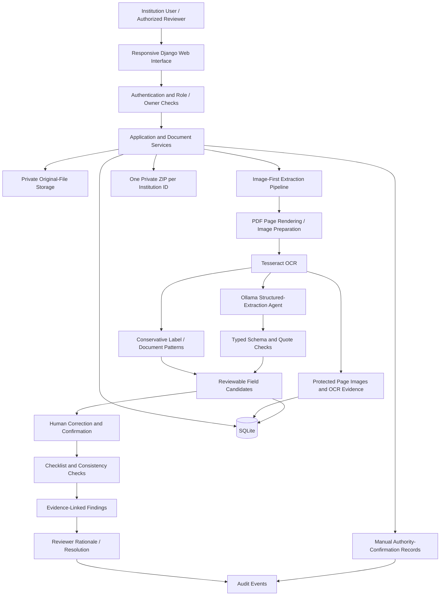

<div align="center">

# AEGIS
### AI-Powered Application Validation, Document Authentication Assistance & Regulatory Compliance Review


</div>

> **Submission status:** This README documents AEGIS v2.3. AEGIS is an independent hackathon prototype, not an official AICTE service, approved AICTE integration or certified regulatory-compliance product. All AI findings are advisory. Competent authorities retain statutory scrutiny, inspections and final decisions.
>
> **Team action before submission:** Fill in the submission-details table below. Do not claim a problem-statement ID, institutional affiliation, endorsement or team membership that has not been confirmed.

---

## Table of Contents

- [Submission Details](#submission-details)
- [Problem Statement](#problem-statement)
- [Our Solution](#our-solution)
- [Key Features](#key-features)
- [System Architecture](#system-architecture)
- [Agent Workflow](#agent-workflow)
- [Supported Documents and Schemas](#supported-documents-and-schemas)
- [Technology Stack](#technology-stack)
- [Getting Started](#getting-started)
- [Configuration](#configuration)
- [Using the Prototype](#using-the-prototype)
- [Institution ZIP Archives](#institution-zip-archives)
- [Security and Responsible AI](#security-and-responsible-ai)
- [Testing and Evaluation](#testing-and-evaluation)
- [Suggested Jury Demonstration](#suggested-jury-demonstration)
- [Project Structure](#project-structure)
- [Current Scope and Limitations](#current-scope-and-limitations)
- [Roadmap](#roadmap)
- [Documentation](#documentation)
- [Team and License](#team-and-license)

## Submission Details

| Item | Details |
|---|---|
| Project name | **AEGIS** |
| Problem statement title | AI-Powered Application Validation, Document Authentication and Regulatory Compliance Verification |
| Intended regulatory context | AICTE technical-institution approval-related processing, as described in the supplied problem statement |
| SIH edition / year | **To be filled by the team** |
| Problem statement ID | **To be filled from the official allocation** |
| Team name / ID | **To be filled by the team** |
| Participating institution | **To be filled by the team** |
| Team leader | **To be filled by the team** |
| Mentor(s) | **To be filled by the team** |
| Repository URL | **To be added** |
| Demo video / presentation | **To be added** |
| Prototype version | **2.3** |

## Problem Statement

Technical-institution approval applications involve multiple categories of evidence: previous approvals, undertakings, accreditation, NOCs, affiliation letters, faculty records, payment receipts and historical compliance information. Manual scrutiny can involve repetitive reading, missing-document checks, validity checks and reconciliation across records.

These tasks become harder when submissions contain scans, inconsistent identifiers, expired evidence, duplicate files or information that must be confirmed with an original issuing authority.

**The challenge:** assist reviewers early in the process without replacing regulatory judgment, assuming restricted database access or treating AI suspicions as proof of misconduct.

## Our Solution

AEGIS is a Django-based decision-support workspace that combines private document intake, image-first OCR, document-specific extraction schemas, local-model assistance, deterministic checks and auditable human review.

Rather than presenting a black-box approval score, AEGIS shows:

- **What was extracted.**
- **Which document and page support the observation.**
- **What is missing, inconsistent or uncertain.**
- **Which checks were completed or unavailable.**
- **What an authorized reviewer did next.**

### Design Differentiators

1. **Document-specific intelligence:** EoA, affidavits, accreditation and receipts use different field contracts instead of a universal checklist of unrelated fields.
2. **Evidence-first AI:** structured AI candidates must satisfy a field schema and cite a matching source-page excerpt before storage.
3. **Graceful AI failure:** OCR and deterministic candidates remain accessible when Ollama is unavailable; unavailable inference is explicitly reported.
4. **Human-controlled outcomes:** reviewer-confirmed transcription is separate from authority confirmation and from regulatory approval.
5. **Institution-centred evidence packaging:** one private ZIP per institution ID consolidates originals across its application records.

## Key Features

### Application Management

- Create institution/application records and unique application references.
- Support Extension of Approval, Increase in Intake, New Programme, Change of Name and New Institution intake categories.
- Search by institution name, institution ID or application reference.
- Filter recorded validation status and open application-specific workspaces.

### Document Intake and Image-First OCR

- Accept PDF, PNG and JPEG uploads up to **15 MB per file**.
- Render processed PDF pages into images with **pypdfium2**.
- Run **Tesseract OCR** on the images; no embedded-PDF-text shortcut is used in the current pipeline.
- Store protected page images, recognized text and average OCR token confidence.
- Display page-level evidence and explicit extraction failures or truncation.

### Structured Extraction and Review

- Support **27 document types** with typed, versioned JSON schemas.
- Automatically attempt Ollama field extraction after OCR on upload.
- Extract applicable scalars, ISO dates and repeatable table rows.
- Allow staff to correct, confirm or reject values with page references and review rationales.
- Refresh field extraction from existing OCR without rerendering the PDF.

### Preliminary Validation and Integrity Signals

- Apply enabled document-presence rules by category and effective date.
- Check declared expiry only for document types that support an expiry field.
- Check confirmed extracted validity and programme-specific accreditation dates.
- Identify institution-name differences and exact identifier absence for review.
- Compare confirmed approved intake for matching course/level/year records.
- Detect identical uploaded files using **SHA-256 fingerprints**.

### Source-Confirmation Assistance

- Record manual source outcomes: pending, verified, mismatch, expired, source unavailable or manual review required.
- Capture source name, evidence reference, checked time, result notes and reviewer identity.
- Require explicit attestation before a manual **Verified** outcome.
- Keep source-confirmation history separate from extraction review.

**No live AICTE, NBA, NAAC, bank or issuing-authority connector is configured.** Manual verification records represent reviewer attestations of separately obtained authorized confirmation—not automated issuer responses.

### Governance and Reporting

- Institution-owner access, staff reviewer access and superuser administration.
- Central dashboard, document library, review inbox and configurable rule screen.
- Required rationales for resolving findings.
- Audit events for key uploads, access, validation, source requests and review actions.
- Role-scoped CSV application-register export.
- Private institution ZIP downloads with a document manifest.

## System Architecture



If the repository viewer does not render Mermaid, the implementation still follows the sequence described below.

```text
Upload → Render Pages → OCR → Schema/Pattern + Ollama Extraction
       → Evidence Review → Validation Findings → Authorized Human Action
```

## Agent Workflow

The prototype uses **bounded Python service functions and model calls**, not an unrestricted autonomous agent swarm.

| Component | Responsibility | Boundary |
|---|---|---|
| Document/OCR agent | Render pages, recognize text, record extraction evidence | OCR output can be wrong; confidence is not authenticity |
| Structured-extraction agent | Propose document-specific fields through Ollama | Typed values and matching quotations still need human review |
| Checklist agent | Check applicable enabled document-presence rules | Shipped rules are illustrative, not a certified handbook mapping |
| Consistency agent | Compare supported identifiers, names, dates and intake records | Differences are review signals, not findings of misconduct |
| Integrity agent | Detect identical-byte document fingerprints | Does not establish manipulation or forgery |
| Infrastructure triage | Route infrastructure evidence for human assessment | Does not measure facilities or replace physical inspection |
| Source-confirmation workflow | Record authorized manual confirmation and unresolved outcomes | No restricted access, autonomous portal browsing or live API is assumed |

### Evidence and Failure Handling

- Unavailable OCR/model services are shown explicitly.
- Missing values remain unknown rather than copied from the application form.
- AI quotes may match across whitespace-only line wraps; fabricated or changed text does not qualify.
- Exact quotation checks establish where an excerpt came from, **not whether the AI interpretation is correct**.
- Reprocessing retains previously confirmed fields as **Recheck required** and replaces stale unconfirmed candidates.
- Existing findings require explicit reviewer reconciliation; uploads do not silently resolve them.

## Supported Documents and Schemas

| Category | Supported records | Representative fields |
|---|---|---|
| Affidavits / undertakings | Generic affidavit, Affidavit I, Affidavit II, institution undertaking | Institution/address, signatory, stamp details, execution date, notary, clauses |
| Accreditation | Generic accreditation, NBA, NAAC | Number/reference, institution, programmes, grade/score, issue/expiry, issuer/seal observation |
| NOCs / permissions | Generic NOC, Fire, Pollution, State Government, course/intake NOC | Relevant reference, issuer, dates, premises, academic year and course/intake data |
| Previous approvals | EoA, affiliation, government order | Application/Permanent IDs, F.No., approval date, year, programme/intake or affiliation scope |
| Intake | Approved intake letter, course-wise records | Course/level, approved/requested intake, year, affiliating body, quota declarations |
| Faculty / institution | Faculty list, appointment, qualification, Principal/Director proof, trust/society records | Personnel rows, qualifications, dates, declared counts, registration/resolution details |
| Compliance | Past deficiency records, self-disclosure | Deficiency/status/deadline and checklist/supporting-reference rows |
| Payments | TER receipt | Application/transaction/reference, amounts, dates, year, gateway and repeatable payment rows |
| History | Full application trail | Cycle IDs, file references, years, outcomes, corrigenda and resolution references |
| Infrastructure | Building/infrastructure evidence | Institution/address, facility declarations and supporting references |

**Applicability matters:** Previous EoA uses **Date of approval**, not a generic expiry field. Expiry appears where configured for accreditation and Fire/Pollution NOCs. An academic year or print timestamp is not an inferred expiry.

Inspect contracts in [`core/schemas.py`](core/schemas.py), browse `/schemas/` after sign-in, or download the exported definitions from [`documentation/schemas/`](documentation/schemas/).

## Technology Stack

| Layer | Technology |
|---|---|
| Backend | Python, Django |
| Database | SQLite through Django ORM |
| Frontend | Django templates, HTML, CSS, JavaScript, inline SVG icons |
| PDF rendering | pypdfium2 |
| OCR | Tesseract executable + pytesseract |
| Image handling | Pillow |
| Local-model integration | Ollama HTTP API through requests |
| Structured validation | JSON Schema / jsonschema |
| Document packaging | Python zipfile, filelock, atomic archive replacement |
| Tests | Django test framework, unittest mocks; browser smoke tests during development |

Runtime dependencies are listed in [`requirements.txt`](requirements.txt). Tesseract and Ollama are separately installed system applications.

## Getting Started

### Prerequisites

- **Python 3.11+** recommended.
- pip and virtual-environment support.
- A modern browser and writable local storage.
- **Tesseract** for OCR.
- **Ollama with an installed model** for AI extraction.

Hardware requirements depend on the selected model and quantization. Use a model that fits the host and evaluate its extraction behavior; no fixed GPU/RAM guarantee is claimed.

### 1. Get the Source

Clone the team's published repository, or extract the supplied source archive. Open a terminal in the directory containing `manage.py`.

The downloadable source excludes user databases, private uploads, page images and secrets.

### 2. Create a Virtual Environment

**Linux / macOS**

```bash
python -m venv .venv
source .venv/bin/activate
```

**Windows PowerShell**

```powershell
python -m venv .venv
.\.venv\Scripts\Activate.ps1
```

Follow organizational execution-policy requirements. Alternatively use the virtual environment's Python executable directly.

### 3. Install Python Dependencies

```bash
python -m pip install -r requirements.txt
```

### 4. Install Tesseract

**Debian / Ubuntu**, using an approved administrator account:

```bash
sudo apt install tesseract-ocr
```

**Windows:** install Tesseract through an approved installer, then set the executable path if it is not on PATH:

```powershell
$env:TESSERACT_CMD = 'C:\Program Files\Tesseract-OCR\tesseract.exe'
$env:OCR_LANG = 'eng'
& $env:TESSERACT_CMD --version
& $env:TESSERACT_CMD --list-langs
```

Replace the path with the actual installation location. The language list must include the configured language, such as `eng`. Installing `pytesseract` with pip does **not** install the OCR executable or its language data.

### 5. Set Up Ollama

Install Ollama using its official installation instructions, then:

```bash
ollama serve
```

If Ollama already runs as a service, do not start a second instance. In another terminal:

```bash
ollama pull qwen2.5:7b
ollama list
```

Configure Django to use that model:

**Linux / macOS**

```bash
export OLLAMA_URL=http://127.0.0.1:11434
export OLLAMA_MODEL=qwen2.5:7b
```

**Windows PowerShell**

```powershell
$env:OLLAMA_URL = 'http://127.0.0.1:11434'
$env:OLLAMA_MODEL = 'qwen2.5:7b'
```

Django calls Ollama server-side. In a remote/container deployment, `127.0.0.1` refers to the Django host/container—not the user's laptop. Use only a trusted inference endpoint.

### 6. Initialize the Database

```bash
python manage.py migrate
```

### 7. Choose a Demo or Admin Setup

For an isolated synthetic demonstration:

```bash
python manage.py seed_demo
```

For account/rule administration:

```bash
python manage.py createsuperuser
```

Both can be used in a controlled synthetic development environment. Do not enable public demo access around real or restricted data.

### 8. Run the Prototype

```bash
python manage.py runserver 0.0.0.0:8000
```

Open **http://localhost:8000** on the server machine, or the provided workspace preview URL.

- **Demo:** select **Explore demo workspace** when `DEMO_MODE=1` and seed data exists.
- **Regular account:** use administrator-issued credentials.
- **Administration:** open `/admin/` as a superuser or appropriately permitted staff account.

The development server is not a production hosting solution.

## Configuration

`.env.example` documents settings, but **`.env` is not automatically loaded**. Export variables in the launching shell or configure the process environment. Restart Django after changes.

| Variable | Default | Purpose |
|---|---|---|
| `DEMO_MODE` | `1` | Public synthetic-reviewer entry; disable before restricted-data use |
| `DJANGO_DEBUG` | `1` | Development errors; disable outside controlled development |
| `DJANGO_SECRET_KEY` | Development fallback | Replace with a strong secret outside development |
| `DJANGO_ALLOWED_HOSTS` | `*` | Preview convenience; restrict to approved hosts for deployment |
| `OLLAMA_URL` | `http://127.0.0.1:11434` | Trusted model runtime reached by Django |
| `OLLAMA_MODEL` | `qwen2.5:7b` | Must match an installed model tag |
| `TESSERACT_CMD` | System PATH | Optional explicit OCR executable path |
| `OCR_LANG` | `eng` | Installed Tesseract language(s) |
| `OCR_MAX_PAGES` | `20` | Maximum processed PDF pages |
| `OCR_RENDER_SCALE` | `2` | Rasterization scale; approximately 144 DPI for standard PDF points |
| `OCR_MAX_PIXELS` | `25000000` | Per-image/page pixel budget |
| `OCR_MAX_CHARACTERS` | `120000` | Document OCR text budget |

### Processing Limits

- Tesseract timeout: **30 seconds per page**.
- Structured Ollama request timeout: **45 seconds**.
- Structured-model input: first **12 page records**, up to **6,000 characters each**.
- Upload processing is synchronous; no background job queue/live progress polling is implemented.

A long document can exceed request/proxy timeouts or extraction limits. Review stage logs and source pages; do not assume complete coverage.

## Using the Prototype

### Institution User

1. Sign in with an assigned non-staff account.
2. Create an application using a consistent institution name and ID.
3. Upload evidence under the correct specific document type.
4. Wait for automatic image/OCR/model processing.
5. Review the extracted-feature summary, source pages and recorded findings.
6. Upload additional authorized evidence where needed.

### Authorized Reviewer

1. Open an application or review-inbox finding.
2. Inspect the original/page image and OCR text.
3. Correct/confirm structured fields with source evidence and a rationale.
4. Run validation and examine evidence-linked concerns.
5. Conduct any required source confirmation through an authorized external process.
6. Record the supported manual outcome, evidence reference and scope.
7. Resolve individual findings only when justified.
8. Rerun validation to refresh application status after review changes.

### Administrator

- Create and deactivate users; assign application owners.
- Configure staff permissions and versioned checklist definitions.
- Manage deployment settings, backups and storage.
- Review authorized rule applicability, effective dates and sources.

### Status Semantics

| Status / label | Interpretation |
|---|---|
| Pending validation | Application has not completed the initial validation workflow |
| Needs attention | At least one unresolved finding existed at the last validation |
| Ready for review | No unresolved findings existed at the last validation; **not approval** |
| Confirmed field | Human-reviewed transcription; **not source authentication** |
| Verification pending | Source-confirmation work remains unresolved |
| Verified — manual | Reviewer attests to separately obtained authorized confirmation; not an automatic API result |
| Ollama unavailable | No usable model extraction was asserted; OCR/pattern results may still exist |

Application status is not automatically recalculated after every upload/resolution. Existing unresolved findings do not auto-close merely because a new document was added.

## Institution ZIP Archives

AEGIS maintains **one private ZIP per normalized institution ID**, combining originals across that institution's application records.

```text
institution-documents.zip
├── manifest.json
├── README.txt
└── applications/
    └── <application-id>-<reference>/
        └── <document-id>/
            └── original-file.pdf
```

- Duplicate filenames remain distinct through document-ID folders.
- ZIPs rebuild on upload and download; originals remain available for OCR.
- Metadata-only seeded records are listed in the manifest without fabricated originals.
- Staff can access the grouped archive. A non-staff user can access it only when all grouped applications belong to that account.
- Grouping is by institution ID, **not a parent-university/affiliated-college hierarchy**.
- Unassigned reference cases stay isolated rather than merging unrelated institutions.

Rebuild existing archives:

```bash
python manage.py rebuild_institution_archives
```

Archives are private filesystem files, not automatically encrypted ZIPs. See [the ZIP guide](documentation/INSTITUTION_ZIP_GUIDE.md) for access rules, failure recovery and stale-file cleanup considerations.

## Security and Responsible AI

### Implemented Safeguards

- Django authentication, CSRF protection and POST-only mutations.
- Owner-scoped access and staff-only reviewer/configuration actions.
- Protected original/page-image/archive delivery; no public media route.
- Upload size and file-signature checks.
- Evidence-linked candidates, typed field validation and explicit unknowns.
- Human rationale and activity logging.
- CSV formula escaping and private/no-store responses for page images/ZIP downloads.
- Explicit distinction between extraction, manual verification and approval.

### Operating Principles

> A duplicate is not proof of fraud. A model observation is not a legal finding. A resolved item is not an authenticated document. Ready for review is not regulatory approval.

Use authorized, anonymized or synthetic records. Do not bypass portal controls or assume access to institutional or issuing-authority databases. Local inference reduces dependence on third-party cloud services only when the configured runtime is actually under approved local control; it is not a confidentiality guarantee by itself.

### Before Real Deployment

Disable demo access and debug mode; configure secrets, explicit hosts, HTTPS/secure cookies and approved identity controls. Add malware scanning, sandboxed parsing, rate limits, encryption/key management, immutable audit storage, retention/deletion rules, asynchronous workers and verified backup/recovery procedures. Obtain legal/security/regulatory review and independent testing.

Prototype audit records remain editable database records. SQLite/files are not automatically encrypted at rest. `is_staff` grants broad reviewer access, not regional/case-assigned access.

## Testing and Evaluation

Run:

```bash
python manage.py check
python manage.py test
```

At the v2.3 development checkpoint, **43 automated tests passed**. Coverage includes authentication, ownership, reviewer permissions, upload checks, OCR/model failure handling, structured-value validation, quote matching, EoA pattern extraction, dynamic expiry applicability, page-image access, ZIP grouping/access and audit behavior.

Browser smoke tests also exercised upload/review screens, conditional expiry inputs, ZIP downloads and mobile overflow. These checks are not a formal security assessment or proof of OCR/AI accuracy.

### Recommended Hackathon Evaluation

| Metric | Suggested measurement |
|---|---|
| OCR quality | Character/word error rate against authorized ground-truth text |
| Field extraction | Per-field precision, recall and exact/normalized match rate |
| Table extraction | Row/cell correctness and missing/merged row rate |
| Validation | Missing/expired/inconsistent-case precision and recall |
| Evidence grounding | Valid page/excerpt linkage and reviewer agreement |
| Source workflow | Completed authorized confirmations and source-unavailable cases, reported separately |
| Efficiency | Per-stage latency and reviewer time against a manual baseline |
| Human usability | Correction effort, false-positive burden and task completion |

**No benchmark accuracy percentage, production throughput, time-saving percentage or successful live-source verification rate is claimed.** Measure these on a separately labeled evaluation set before including numbers in the SIH presentation.

## Suggested Jury Demonstration

Use an isolated synthetic dataset. Do not expose confidential source documents or credentials.

| Step | Demonstration | Expected observation |
|---|---|---|
| 1 | Enter demo workspace | Dashboard and synthetic applications |
| 2 | Create an institution application | Unique reference and owner-scoped record |
| 3 | Upload a readable PDF | Page image → OCR → automatic model attempt |
| 4 | Inspect structured review | Document-specific fields, evidence and uncertainty |
| 5 | Demonstrate an EoA | Approval date/F.No./year; no unrelated expiry field |
| 6 | Upload a synthetic expired Fire NOC | Applicable expiry concern after validation |
| 7 | Upload identical bytes twice | Duplicate-fingerprint review signal |
| 8 | Run with Ollama unavailable | Explicit unavailable state; no fabricated model result |
| 9 | Correct/confirm a field and resolve a supported finding | Rationale and audit events |
| 10 | Download institution ZIP | Original evidence grouped across the institution's applications |
| 11 | Sign in as another institution user | Unauthorized records/images/archives remain inaccessible |

If showing a manual Verified outcome, use a clearly labeled synthetic authority-response exercise and disclose that no live authority connector is running. Never present a fabricated confirmation as real authentication.

## Project Structure

```text
AEGIS/
├── manage.py
├── requirements.txt
├── .env.example
├── config/
│   ├── settings.py                  # Django / SQLite / OCR / Ollama settings
│   └── urls.py
├── core/
│   ├── models.py                    # Applications, documents, pages, fields, findings, logs
│   ├── schemas.py                   # Document-specific typed extraction contracts
│   ├── extraction.py                # Page rendering, OCR and Ollama extraction
│   ├── agents.py                    # Preliminary validation orchestration
│   ├── review_checks.py             # Confirmed-field consistency / validity checks
│   ├── archives.py                  # Private institution ZIP generation
│   ├── views.py                     # Scoped workflows and protected file delivery
│   ├── urls.py
│   ├── tests.py
│   ├── fixtures/                    # Extraction regression example
│   ├── migrations/
│   └── management/commands/
│       ├── seed_demo.py
│       ├── rebuild_institution_archives.py
│       └── import_reference_documents.py
├── templates/core/                  # Dashboard, intake and evidence-review screens
├── static/core/                     # Responsive styles and interaction scripts
└── documentation/
    ├── schemas/                     # Exported JSON contracts
    └── *.md                         # Operating and upgrade guides
```

`db.sqlite3` and `private_documents/` are created locally and must not be committed. Protect database backups, originals, rendered images and generated archives together.

## Current Scope and Limitations

| Area | Functional prototype | Not yet implemented / not claimed |
|---|---|---|
| Portal integration | Django services and institution/application records | Live AICTE portal integration or restricted-record synchronization |
| Extraction | Image-first OCR, patterns, optional Ollama, manual review | Guaranteed accurate table parsing or complete long-document coverage |
| Classification | Uploader-selected supported type | Trained automatic semantic document classification |
| Authentication | Manual outcome/evidence-reference history | Live issuer APIs, validated QR, cryptographic signature or seal authentication |
| Forensics | Identical-file SHA-256 matching | Conclusive forgery/manipulation detection |
| Regulation | Configurable document-presence rules and selected consistency checks | Certified handbook pack or exhaustive legal/numeric compliance logic |
| Infrastructure | Human-review routing | Computer-vision facility measurements or physical-compliance certification |
| Notifications | In-app findings/inbox | Email/SMS, scheduled reminders or SLA escalation |
| Governance | Roles, rationales, audit events | Immutable ledger, dual authorization, full evidence supersession/reopening |
| Operations | SQLite, private local storage, synchronous requests | Production scale, asynchronous workers, SSO/MFA or automatic retention enforcement |

Supplied reference attachments were technically processed in a separate local review database, not mixed into the public demo. They concern different institutions and include blank templates and a website EoA printout. Technical extraction is not a confirmation of their authenticity or current validity.

## Roadmap

- Map requirements to officially approved handbook versions, clauses, categories and exceptions.
- Implement documented, authorized issuing-authority adapters with signed/schema-validated response evidence.
- Add asynchronous extraction/model jobs, progress reporting, bounded retries and resource monitoring.
- Improve layout-aware/cell-level table extraction and multipage/multiletter segmentation.
- Add calibrated confidence, extraction benchmarks and human-review quality evaluation.
- Implement approved affidavit-template comparisons and richer cross-record reconciliation.
- Add case assignment, institutional teams, SSO/MFA and fine-grained permissions.
- Add append-only audit storage, evidence versions, retention and verified recovery controls.
- Pilot with authorized users and independently evaluate security, accessibility and reviewer effort.

These items are planned extensions—not existing prototype capabilities.

## Documentation

- [Complete user manual](AEGIS_User_Manual.md)
- [User manual — Word](AEGIS_User_Manual.docx)
- [Document-specific feature and EoA repair guide — v2.3](documentation/DOCUMENT_SPECIFIC_FEATURES_V2_3.md)
- [Automatic OCR/Ollama pipeline guide](documentation/AUTOMATIC_OCR_PIPELINE.md)
- [Institution ZIP guide](documentation/INSTITUTION_ZIP_GUIDE.md)
- [Structured schema and source-review guide](documentation/SCHEMA_AND_EXTRACTION_V2.md)
- [Reference extraction smoke-test report](Reference_Extraction_Report.md)

The v2.3 guide supersedes earlier universal seven-field descriptions. Earlier manuals describe historical behavior where explicitly overridden by newer guides.

### Troubleshooting Quick Reference

| Symptom | First check |
|---|---|
| PDF rendering succeeds, OCR fails | Tesseract executable/path, installed language data and extraction log |
| OCR readable, fields missing | Selected type, model status and candidate rejections; use **Refresh fields from existing OCR + retry Ollama** |
| Ollama connected but extraction unavailable | Installed model tag, memory, timeout and response format |
| Missing-document finding remains after upload | Reviewer must explicitly resolve the earlier finding and rerun validation |
| Institution ZIP denied | Other grouped applications may belong to another owner |
| Seeded original cannot be downloaded | Synthetic seed metadata may have no original file attached |
| Environment changes do not apply | Export variables in the server process environment and restart; `.env` is not auto-loaded |


---

<div align="center">

**Evidence before conclusions. Human judgment before regulatory action.**

*AEGIS supports scrutiny. Competent authorities decide.*

</div>
